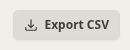

Zen Reporter includes a zero-dependency, RFC 4180-compliant CSV export engine. It allows QA engineers, lead developers, and managers to extract filtered test execution datasets into raw CSV format for downstream analysis in Microsoft Excel, Google Sheets, or business intelligence tools (e.g., Tableau, PowerBI).

---

## 📊 Overview & UI Access

In all major tabular views throughout the dashboard (Spec Files table, History tables, File & Test History tables, Insights tables), a prominent **Export CSV** button is available:

Clicking the button immediately triggers a browser download of the actively rendered table dataset.

---

## 🛠️ Key Capabilities & Technical Specifications

### 1. Strict RFC 4180 Compliance

The exporter utility formats all data fields according to RFC 4180 standards:

- Fields containing commas, quotation marks, or newline characters are wrapped in double quotes.
- Internal quotation marks are escaped via double-quote pairs (`""`).

### 2. UTF-8 Byte Order Mark (BOM) Support

To prevent character encoding errors when opening CSV files in Microsoft Excel on Windows or macOS, Zen Reporter prepends the UTF-8 BOM byte sequence (`\uFEFF`) to every generated CSV file. Non-ASCII characters (such as status symbols, tags, or execution identifiers) render properly automatically.

### 3. Respects Active UI Filters & Search Terms

The CSV exporter operates dynamically on the user's active view context:

- **Search Filters**: Only rows matching your current search query (e.g., search term or spec file name) are exported.
- **Date Range Filters**: Presets and custom date ranges selected in historical views are strictly respected.
- **Project Dropdowns**: Respects active project and browser selections.

#### Dynamic File Naming

Exported filenames are generated dynamically to describe the exact dataset, active filter state, search query, and export timestamp:

| Filter Scenario | Example Generated Filename |
| :--- | :--- |
| **Preset Date Filter** | `flaky-tests_last-30-days_2026-10-05_1430.csv` |
| **Single Month Range** | `flaky-tests_october-2026_2026-10-05_0915.csv` |
| **Custom Multi-Month Range** | `flaky-tests_2026-08-01-to-2026-10-05_2026-10-05_1845.csv` |
| **Combined Search & Preset** | `test-runs-history_last-30-days_search-login_2026-10-05_1105.csv` |
| **No Active Filter** | `slowest-tests_2026-10-05_1430.csv` |

### 4. Full Un-paginated Dataset Extraction

Unlike simple DOM table scraping utilities, Zen Reporter's CSV engine exports the **entire underlying dataset**. Even if your UI table is configured to display only 10 rows per page across 50 pages (500 total rows), clicking **Export CSV** exports all 500 records into a single CSV file.

---

## 📑 Supported Export Tables

- **Test Results by File Table [Files tab]**: Spec file path, total tests, passed, failed, timed out, interrupted, skipped, and pass rate %.
- **Execution Runs History Table [History tab]**: Run name, execution mode/workers, start timestamp, wall-clock duration, time saved via parallelism, status counts (passed, failed, skipped, timed out, interrupted), and pass rate %.
- **File Execution History Table [History tab]**: Spec file path, total runs, total test executions, outcome counts, and historical pass rate %.
- **Test Case History Table [History tab]**: Test case title, describe suite, spec file path, project profile, total runs, outcome counts, average duration, and historical pass rate %.
- **Insights & Intelligence Tables [Insights tab]**: Flaky tests list, regression list, and top slowest test cases.
