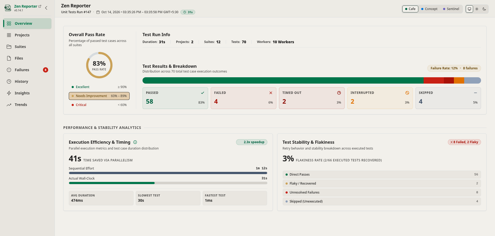

The **High-Level Dashboard** (accessible via the **Overview** tab) serves as the executive summary and health control center for your test suite execution. It transforms thousands of raw assertion points into clear, actionable KPI indicators.

---

## 🔍 Key Dashboard Sections & Metrics

### 1. Header & Navigation Context

The top bar and run header display key execution context:

- **Test Run Title & Run Number**: Indicates the test run suite and execution ID (e.g., `Unit Tests Run #145`).
- **Timestamp & Duration Pill**: Shows execution date, start/end timestamps with timezone, and total execution duration (e.g., `31s`).
- **Theme & Mode Selectors**: Quick switches for dashboard themes and light/dark mode selection.

---

### 2. High-Level Execution Summary

The top section provides an immediate health check and high-level breakdown of the run:

#### Overall Pass Rate

- **Radial Pass Rate Gauge**: Prominent circular donut chart displaying the suite's overall pass rate percentage (e.g., `83% PASS RATE`).
- **Health Tier Thresholds / Legend**:
  - 🟢 **Excellent (≥ 90%)**: High suite stability.
  - 🟡 **Needs Improvement (60% – 89%)**: Moderate failure rates requiring attention.
  - 🔴 **Critical (< 60%)**: Severe failure state requiring immediate triage.

#### Test Run Info

A concise summary card displaying key environment and scope metrics:

- **Duration**: Total wall-clock time (e.g., `31s`).
- **Projects**: Total number of configured projects/browsers (e.g., `2`).
- **Suites**: Total number of suites/spec files (e.g., `12`).
- **Tests**: Total test cases evaluated (e.g., `70`).
- **Workers**: Number of parallel worker threads allocated (e.g., `10 Workers`).

#### Test Results & Breakdown

- **Distribution Stacked Progress Bar**: A horizontal proportional bar representing the distribution across all execution outcomes, accompanied by a summary badge (e.g., `Failure Rate: 12% • 8 failures`).
- **Outcome Status Cards**: Distinct status cards with counts, percentage shares, and status icons:
  - 🟢 **PASSED**: Count and percentage of successful tests (e.g., `58` | `83%`).
  - 🔴 **FAILED**: Count and percentage of assertion or runtime failures (e.g., `4` | `6%`).
  - 🟣 **TIMED OUT**: Count and percentage of tests exceeding timeouts (e.g., `2` | `3%`).
  - 🟠 **INTERRUPTED**: Count and percentage of abruptly terminated or aborted tests (e.g., `2` | `3%`).
  - 🟡 **SKIPPED**: Count and percentage of intentionally skipped test cases (e.g., `4` | `5%`).

---

### 3. Performance & Stability Analytics

A dedicated analytics section divided into two main panels:

#### Execution Efficiency & Timing

Measures parallel execution performance and timing metrics:

- **Header Badges**: Includes tooltip information and a speedup factor pill (e.g., `2.2x speedup`).
- **Time Saved Via Parallelism**: Highlights the net time saved by running tests concurrently across workers (e.g., `37s TIME SAVED VIA PARALLELISM`).
- **Sequential Effort vs. Actual Wall-Clock**: Comparative progress bars illustrating:
  - **Sequential Effort**: Cumulative execution duration if run sequentially (e.g., `1m 9s`).
  - **Actual Wall-Clock**: Total real time elapsed (e.g., `31s`).
- **Timing Benchmarks**:
  - **AVG DURATION**: Average test duration across all tests (e.g., `475ms`).
  - **SLOWEST TEST**: Duration of the slowest test case in the run (e.g., `30s`).
  - **FASTEST TEST**: Duration of the fastest test case (e.g., `1ms`).

#### Test Stability & Flakiness

Analyzes retry behavior and stability across executed tests:

- **Flakiness Rate Metric**: Prominent percentage indicator highlighting recovered test cases relative to total executed tests (e.g., `3% FLAKINESS RATE (2/66 EXECUTED TESTS RECOVERED)`).
- **Issue Summary Badge**: Header pill summarizing failures and flaky tests (e.g., `✕ 8 Failed, 2 Flaky`).
- **Stability Breakdown**:
  - 🟢 **Direct Passes**: Tests passing on initial execution without retries.
  - 🟡 **Flaky / Recovered**: Tests that failed initially but succeeded after retry.
  - 🔴 **Unresolved Failures**: Tests that failed even after retry attempts.
  - ⚪ **Skipped (Unexecuted)**: Bypassed or unexecuted test cases.

---

## 💡 How to Use the Dashboard

1. **Daily CI Monitoring**: Check the **Overall Pass Rate** and **Test Results & Breakdown** cards for immediate build health.
2. **Parallelism & Performance Tuning**: Review **Execution Efficiency & Timing** to measure the impact of adjusting worker threads in your configuration.
3. **Flakiness Triage**: Check **Test Stability & Flakiness** to spot unreliable tests that recover on retry before they become permanent failures.
