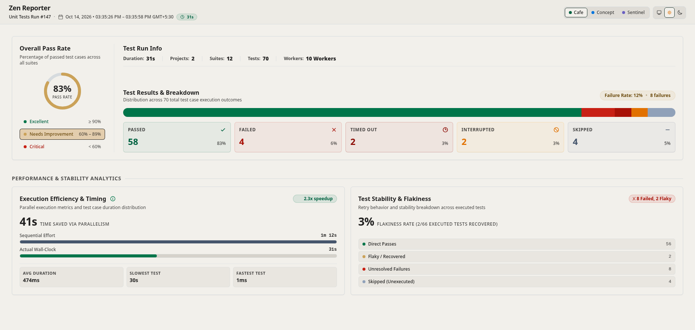

When configured with `singleSummaryFile: true`, Zen Reporter generates a standalone, lightweight executive summary report named `summary.html` in your output directory alongside `index.html`.

---

## 📑 Purpose & Target Audience

While `index.html` is designed for interactive deep-dive debugging with complete step execution traces, inline source code snippets, and trace file attachments, `summary.html` is tailored specifically for:

- **Engineering Management & Leadership**: Quick release readiness assessments.
- **QA & Product Stakeholders**: High-level test pass/fail ratio metrics.
- **Automated Notifications**: Light HTML report attachments for Slack notifications, email summaries, or release audit documentation.

---

## ⚙️ Enabling `summary.html`

Enable executive summary generation in `playwright.config.ts`:

```typescript
import { defineConfig } from '@playwright/test';

export default defineConfig({
  reporter: [
    [
      '@arpanp/zen-reporter',
      {
        outputDir: 'zen-report',
        singleSummaryFile: true, // Generates summary.html alongside index.html
      },
    ],
  ],
});
```

---

## 🔍 Visual Components & Features

`summary.html` provides the complete high-level dashboard layout in a standalone, single-page presentation without navigation sidebars, failure stack traces, or large media attachments:



<a href="/demo/summary.html" target="_blank" rel="noopener
  noreferrer">Summary - Live Demo</a>

### Key Dashboard Sections in `summary.html`

- **Persistent Header Bar**: Displays the project name, test run identifier (e.g., `Unit Tests Run #146`), start and end timestamps, wall-clock duration pill (`⏱ 31s`), segmented theme picker (`Cafe`, `Concept`, `Sentinel`), and 3-way appearance toggle (System, Light, Dark).
- **Overall Pass Rate Gauge**: Prominent radial donut chart indicating the suite's pass rate (e.g., `77% PASS RATE`) along with health threshold tiers (🟢 Excellent $\ge 90\%$, 🟡 Needs Improvement $60\% - 89\%$, 🔴 Critical $< 60\%$).
- **Test Run Info**: Inline summary metrics detailing test run Duration, Project count, Suite count, Test count, and parallel Worker thread allocation.
- **Test Results & Breakdown**: Proportional outcome stacked progress bar (with overall failure rate badge) and dedicated outcome status cards for `PASSED`, `FAILED`, `TIMED OUT`, `INTERRUPTED`, and `SKIPPED` cases.
- **Performance & Stability Analytics**:
  - **Execution Efficiency & Timing**: Highlights speedup multiplier (e.g., `2.5x speedup`), time saved via parallel worker execution (`45s TIME SAVED VIA PARALLELISM`), comparative progress bars (*Sequential Effort* vs. *Actual Wall-Clock*), and test timing benchmarks (*Avg Duration*, *Slowest Test*, *Fastest Test*).
  - **Test Stability & Flakiness**: Tracks flakiness recovery rate (e.g., `3% FLAKINESS RATE (2/66 EXECUTED TESTS RECOVERED)`), anomaly counter badge, and category breakdown (*Direct Passes*, *Flaky / Recovered*, *Unresolved Failures*, *Skipped*).

---

### Key Differences (`summary.html` vs `index.html`)

| Feature | `index.html` (Full Interactive Report) | `summary.html` (Executive Summary) |
| :--- | :--- | :--- |
| **Sidebar Navigation** | Full collapsible sidebar (Overview, Projects, Suites, Files, Failures, History, Insights, Trends) | **No sidebar** — single clean executive view |
| **Deep-Dive Failure Traces** | Full step-by-step traces (`▶`), syntax-highlighted code frames, text diffs, clipboard copy | High-level status breakdown & failure counts only |
| **Media Attachments** | Inline screenshots, interactive video player, and Playwright `.zip` traces | Excluded to ensure ultra-fast loading & small file size |
| **Historical & AI Analytics** | Full DuckDB regression tracking, file/test histories, and trend charts | Focused on the current execution run summary |
| **File Size & Portability** | Larger (comprehensive test artifacts and deep diagnostic logs) | Extremely lightweight single-file HTML ideal for email, Slack, or CI release artifacts |
