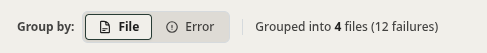
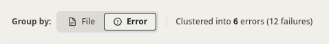
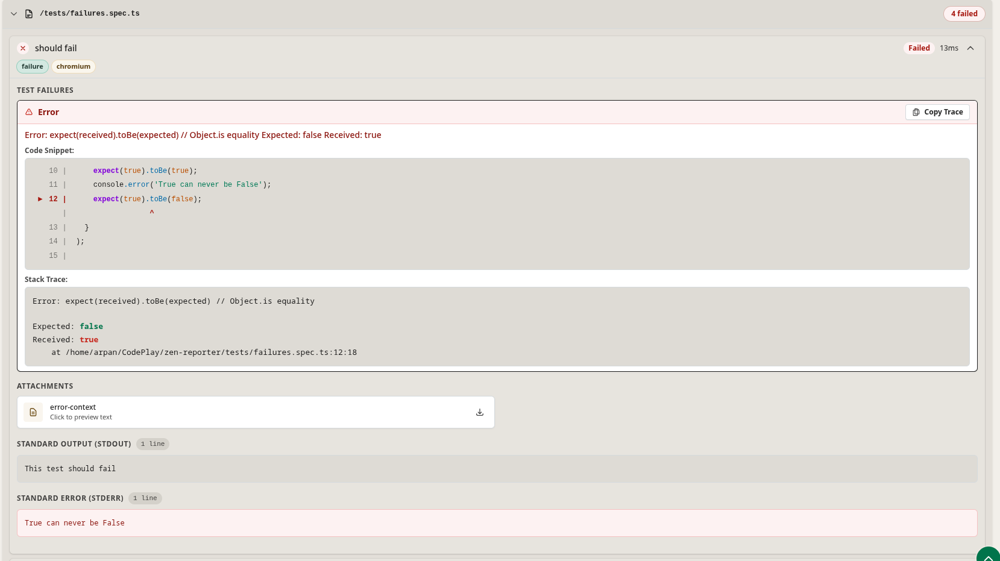
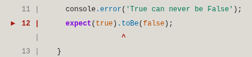
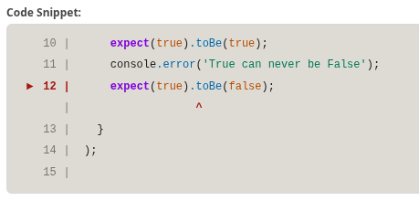
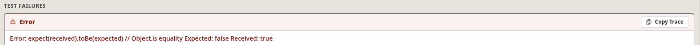
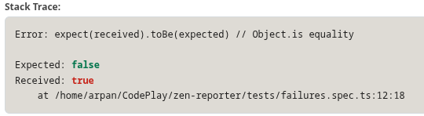
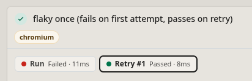
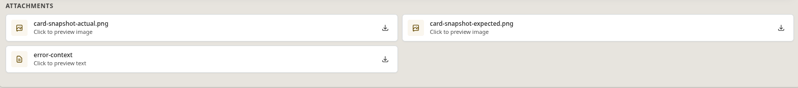

When test runs fail, identifying root causes quickly is critical. Zen Reporter's **Failures** tab provides an advanced error diagnostic engine featuring error signature clustering, step-by-step trace step execution, source code syntax highlighting, and retry attempt inspection.

---

## 🔍 Failure Grouping Modes

At the top of the **Failures** tab, users can toggle between two intelligent failure grouping modes:

```text
  [ Group by File ]   vs.   [ Cluster by Error Signature (Shared Issues) ]
```

<div align="center">



</div>

<div align="center">



</div>

### 1. Group by File

Organizes test failures by their parent spec file path. Ideal when debugging a broken spec file locally.

### 2. Cluster by Error Signature (Shared Issue Clusters)

Analyzes stack trace messages and error locations across all failed tests to cluster failures sharing identical root causes.

- **Problem Solved**: If an authentication API goes down, 50 different test cases across 10 spec files might fail with `Error: 500 Internal Server Error at /api/login`.
- **Zen Reporter Solution**: Groups all 50 failures into a single **Shared Issue Cluster**. QA engineers analyze and document 1 root cause instead of triage 50 individual items.

---

## 🛠️ Granular Failure Inspection Tools

Clicking on any failed or retried test case expands a rich diagnostic view containing execution steps, failure messages, code frames, and artifacts:



---

## 🔍 Key Diagnostic Capabilities

### 1. Step-by-Step Execution Steps & Target Step Indicator (`▶`)

The **Execution Steps** section provides a collapsible list of all hooks and test steps (e.g., `Before Hooks`, test steps, `After Hooks`, `Worker Cleanup`) with step runtimes:

- Pinpoints the exact line where Playwright execution aborted with a prominent target arrow indicator (`▶`).
- Displays step duration (e.g., `5ms`, `2ms`, `10ms`) for every hook and action.

<div align="center">



</div>

### 2. Syntax-Highlighted Code Frame Snippets

Extracts source code lines directly from Playwright test files and renders inline syntax highlighting with context lines surrounding the failed assertion line, highlighting the specific failed line and character pointer (`^`).

<div align="center">



</div>

### 3. Error Callout & One-Click "Copy Trace" Button

The **Test Failures** card highlights the root error message in an alert banner:

- **Copy Trace Button**: A dedicated **Copy Trace** button located in the error header allows engineers to instantly copy the entire raw stack trace and assertion failure message to the clipboard with a single click—making it effortless to paste into Jira tickets, Slack discussions, or terminal debug sessions.



### 4. Structured Diff & Stack Trace (`Expected` vs. `Received`)

For Playwright `expect()` value assertion mismatches, Zen Reporter formats visual color-coded text diffs highlighting exact string or JSON object discrepancies:

- 🟢 **Expected**: Expected object structure or baseline text (e.g., `Expected: false`).
- 🔴 **Received**: Actual runtime output returned by the application under test (e.g., `Received: true`).
- **Stack Trace Location**: Displays the precise file path and line number where the assertion failed.

<div align="center">



</div>

### 5. Retry Attempt Inspection Tabs (`Run`, `Retry #1`, `Retry #2`)

When Playwright retries flaky tests (`retries: 2` in `playwright.config.ts`), Zen Reporter creates dedicated tab panels for each execution attempt (e.g., `● Run (Failed · 18ms)` and `● Retry #1 (Passed · 10ms)`). Users can inspect trace steps, console logs, and failure details for both the initial failing attempt and subsequent retries in a single place.

<div align="center">



</div>

### 6. Attachments & Artifact Integration

Direct access to Playwright test artifacts:

- **Text Artifacts**: Inline previews for text file artifacts (e.g., `error-context`).
- **Screenshots**: Inline image previews for failure snapshots.
- **Videos**: Built-in video player for test execution recordings (`video: 'retain-on-failure'`).
- **Binary Artifacts**: Fallback preview that allow downloading of binary attachments.


