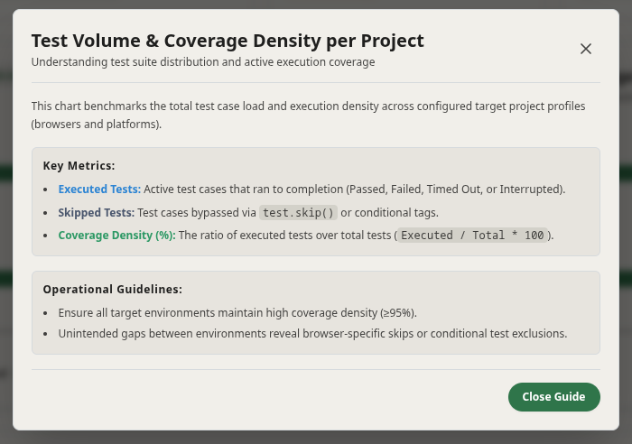

Zen Reporter provides contextual **Guide Modals** across major analytics sections in the HTML dashboard. These modals offer on-demand domain knowledge, methodology explanations, quality target thresholds, and actionable remediation steps directly within the UI.

---

## Overview

Guide Modals bridge raw test automation metrics with actionable engineering insights. Each major reporting tab features dedicated **"Learn more"** triggers that open centered, accessible overlay dialogs.

---

## Key Features & Accessibility

1. **On-Demand Context**: Accessible via visual **"Learn more"** buttons placed in section headers.
2. **Keyboard Navigation & Esc Key Support**: Modals listen for `Escape` key presses to instantly close.
3. **Backdrop Click-to-Close**: Clicking the dimmed backdrop overlay dismisses the guide modal.
4. **Theme & Dark Mode Awareness**: Fully styled using Zen Reporter's design tokens to maintain contrast in light and dark mode themes.

---
