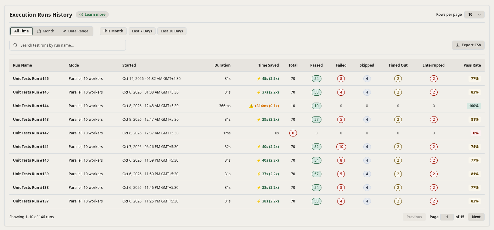
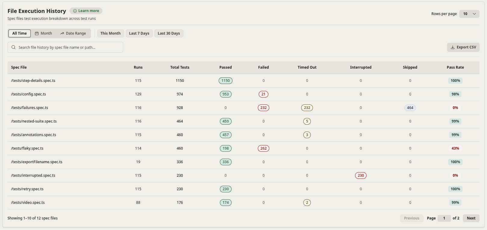
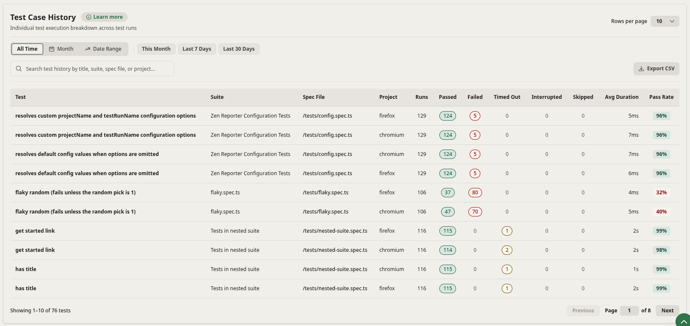
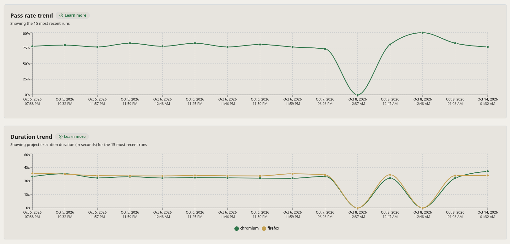
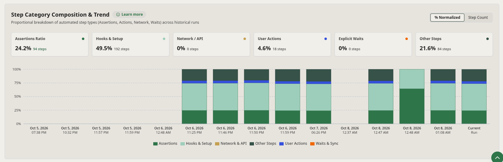

Tracking test suite health over time is essential for identifying degradation before releases. Zen Reporter automatically logs execution runs to JSONL archives and provides interactive historical views: **History**, **File History**, and **Test History**.

---

## 📦 JSONL Archive Mechanism

When history archiving is enabled (`enableHistory: 'auto'` or `true`), Zen Reporter writes a lightweight `.jsonl` record for every test run to:

```text
<outputDir>/runs/<run_id>.jsonl
```

### JSONL Schema Structure

Each line in a run JSONL file records a flattened test case result alongside run-level summary metrics and step statistics.

#### Field Reference

- **Run Metadata & Benchmarks**:
  - `run_id`: Unique timestamped identifier for the execution run.
  - `run_name`: Test run name (e.g., `"Unit Tests Run #146"`).
  - `project_name`: Configured project title (e.g., `"Zen Reporter"`).
  - `started_at` / `ended_at`: ISO timestamp strings for run start and completion.
  - `run_duration_ms`: Total wall-clock execution duration in milliseconds.
  - `run_sequential_duration_ms`: Cumulative execution duration across worker threads.
  - `run_workers` / `run_projects`: Worker threads and Playwright project profiles utilized.
- **Run Outcome Totals**:
  - `run_total`, `run_passed`, `run_failed`, `run_skipped`, `run_timed_out`, `run_interrupted`: Overall execution counts for the run.
- **Run Step Categorization**:
  - `step_assertions`, `step_actions`, `step_network`, `step_hooks`, `step_waits`, `step_others`: Total step occurrences per category across the entire run.
- **Individual Test Case Attributes**:
  - `file`: Relative test spec file path.
  - `suite`: Parent `describe` suite title hierarchy.
  - `title`: Test case title.
  - `project`: Target Playwright project profile (e.g., `"chromium"`).
  - `status`: Outcome (`passed`, `failed`, `timedOut`, `skipped`, `interrupted`).
  - `duration_ms`: Test execution duration in milliseconds.
  - `attempts` / `failed_attempts`: Total execution attempts and failed attempts.
  - `passed_on_retry`: Boolean flag indicating if the test recovered on retry (flaky test).
  - `error_message`, `error_stack`, `error_file`, `error_line`: Error diagnostics and location if the test failed.
  - `tags`: Array of custom `@tag` annotations attached to the test or suite.

---

## 📊 History Tab Views

The **History** tab in the report UI offers three sub-views:

### 1. Execution Runs History View

Lists past test execution runs in reverse chronological order:



- **Date Range & Filter Presets**: Quick preset filter buttons (`All Time`, `Month`, `Date Range`, `This Month`, `Last 7 Days`, `Last 30 Days`).
- **Live Search & Export**: Filter runs by run name (`Search test runs by run name...`) and one-click **Export CSV** button.
- **Detailed Run Table Columns**:
  - **Run Name**: Custom run identifier (e.g., `Unit Tests Run #146`).
  - **Mode**: Execution mode and worker allocation (e.g., `Parallel, 10 workers`).
  - **Started**: Formatted start timestamp with timezone.
  - **Duration**: Total execution wall-clock time (e.g., `31s`, `366ms`).
  - **Time Saved**: Calculated parallelism time savings and speedup multiplier (e.g., `⚡ 45s (2.5x)`), or yellow slowdown warnings if sequential effort was lower.
  - **Status Breakdown**: Pill-highlighted counts for `Total`, `Passed` (green), `Failed` (red), `Skipped` (soft blue), `Timed Out` (amber), and `Interrupted` (red).
  - **Pass Rate**: Overall run pass percentage badge (e.g., `77%`, `83%`, `100%`, `0%`).
- **Pagination**: Configurable page size (`Rows per page: 10`) with `Previous` and `Next` navigation.

---

### 2. File Execution History View

Aggregates historical performance at the spec file level across all executed runs:



- **Filter & Search Toolbar**: Preset date filters (`All Time`, `This Month`, etc.), instant search input (`Search file history by spec file name or path...`), and `Export CSV` button.
- **Spec File Metrics Columns**:
  - **Spec File**: Relative file path of the test spec.
  - **Runs**: Total number of runs that included this spec file (e.g., `115`, `129`).
  - **Total Tests**: Cumulative test cases executed from this file across all runs.
  - **Historical Outcome Totals**: Aggregated counts for `Passed`, `Failed`, `Timed Out`, `Interrupted`, and `Skipped`.
  - **Pass Rate**: Cumulative historical pass percentage for the spec file (e.g., `100%`, `98%`, `43%`, `0%`).

---

### 3. Test Case History View

Provides granular historical tracking for individual test cases across runs:



- **Multi-Field Search**: Live search filtering by test title, suite, spec file, or project name (`Search test history by title, suite, spec file, or project...`).
- **Granular Test Case Columns**:
  - **Test**: Name / title of the individual test case.
  - **Suite**: Name of the parent `describe` suite.
  - **Spec File**: Source spec file path.
  - **Project**: Playwright browser profile (`chromium`, `firefox`, etc.).
  - **Runs**: Total runs evaluating this test.
  - **Outcome Totals**: Cumulative `Passed`, `Failed`, `Timed Out`, `Interrupted`, and `Skipped` counts.
  - **Avg Duration**: Historical average execution duration for the test case (e.g., `5ms`, `7ms`, `2s`).
  - **Pass Rate**: Cumulative pass rate percentage badge.

---

## 📈 Trends View & Charts

The **Trends** tab in the report UI visualizes long-term quality, performance, and test composition metrics across historical runs:



- **Pass Rate Trend Chart**:
  - Interactive line chart tracking pass rate percentages across the 15 most recent runs, highlighting quality spikes or drops.
  - Hover tooltips provide exact timestamps and pass rates for each historical run point.

- **Duration Trend Chart**:
  - Multi-line chart displaying execution wall-clock time (in seconds) for each Playwright project profile (`chromium`, `firefox`) across recent runs.
  - Easily spot duration spikes, performance regressions, or browser-specific slowdowns.

- **Step Category Composition & Trend Chart**:
  - **View Modes**: Toggle between **`% Normalized`** (proportional stacked bar breakdown) and **`Step Count`** (raw count distribution).
  - **Top KPI Summary Cards**: Live breakdown of current step distribution:
    - 🟢 **Assertions Ratio**: Proportion and count of `expect` assertions (e.g., `24.2% · 94 steps`).
    - 🟢 **Hooks & Setup**: Time spent in fixtures and lifecycle hooks (e.g., `49.5% · 192 steps`).
    - 🟡 **Network / API**: Proportion and count of network and API requests.
    - 🔵 **User Actions**: UI interactions like clicks, fills, and navigation (e.g., `4.6% · 18 steps`).
    - 🟠 **Explicit Waits / Sync**: Time spent waiting on elements or timeouts.
    - 🟢 **Other Steps**: Miscellaneous test steps and framework internals (e.g., `21.6% · 84 steps`).
  - **Historical Stacked Bar Comparison**: Compare historical runs side-by-side against the **Current Run** to catch setup bloat, runaway hooks, or missing assertion steps.



---

## 💡 Managing History Archives

### Rebuilding History Analytics (`zr history report`)

If you add or modify `.jsonl` files in `<outputDir>/runs/`, re-run the CLI aggregator command to update `history.json` and inject updated metrics into `index.html`:

```bash
npx zr history report
```

### Disabling History

For single-run disposable CI environments, disable history archiving by setting `enableHistory: false` or `minimalReport: true` in your [Playwright config](../../configuration/#7-minimalreport-boolean).
