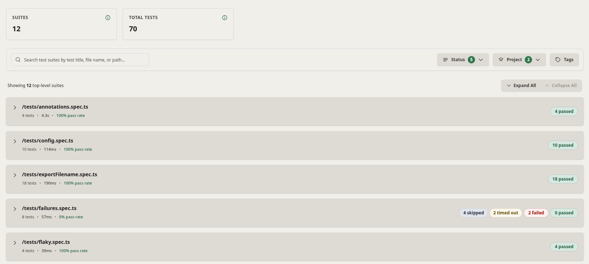
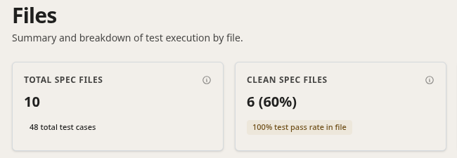
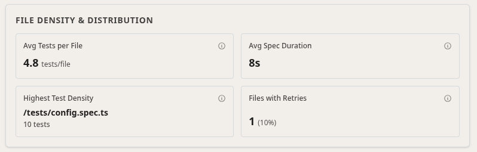
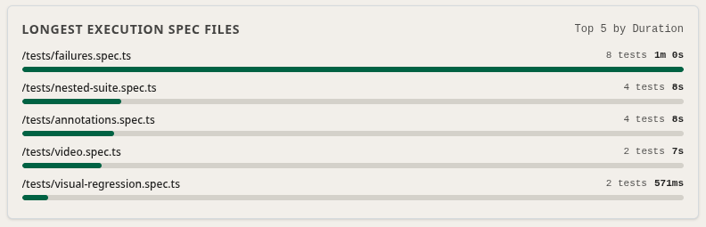
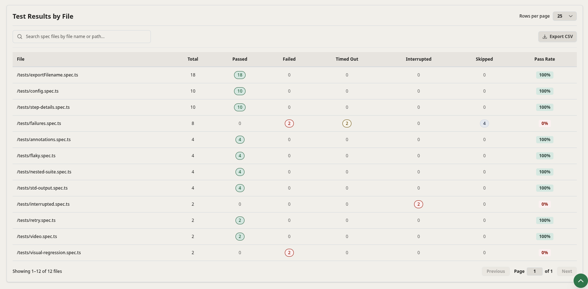

Viewing test results of a large test suites with hundreds of `describe` blocks and spec files can be overwhelming. Zen Reporter provides two dedicated explorer views: **Suites** (interactive tree view) and **Files** (paginated spec file metrics table).

---

## 🌳 Interactive Suite Tree (`Suites` Tab)

The **Suites** tab presents your test suites and spec files in an interactive, collapsible hierarchy tree view.

### Key Features of Suite View

- **Top Suite KPI Cards**: Summary cards at the top showing high-level test run metrics:
  - **Suites**: Total count of evaluated suites (e.g., `12`).
  - **Total Tests**: Total count of test cases evaluated across suites (e.g., `70`).
- **Search & Multi-Dimensional Filtering Toolbar**:
  - **Live Search**: Instant search input filtering suites by test title, file name, or spec path.
  - **Status Filter**: Dropdown with badge count (e.g., `Status (5)`) to filter by execution outcome (Passed, Failed, Timed Out, Interrupted, Skipped).
  - **Project Filter**: Dropdown with badge count (e.g., `Project (2)`) to filter across Playwright project configurations.
  - **Tags Filter**: Tag selector button to filter by custom `@tag` annotations.
- **Bulk Expand / Collapse Controls**: Quick-action buttons (`Expand All` / `Collapse All`) alongside the suite count indicator (e.g., `Showing 12 top-level suites`).
- **Collapsible Suite & File Cards**:
  - Shows file path (e.g., `/tests/failures.spec.ts`), test count, execution duration (e.g., `57ms`), and pass rate percentage (e.g., `0% pass rate`).
  - Color-coded outcome pills on each card summarizing results: `passed`, `failed`, `timed out`, `interrupted`, and `skipped`.
- **Nested Describe & Test Hierarchy**: Infinite nesting support for `test.describe()` groups and individual test case steps with collapsible tree toggles.
- **Inline Test Case Details & Attachments**: Click on any test node to view step execution logs, retry attempt history, failure code frames, video recordings, screenshots, and Playwright `.zip` traces.

---

## 📄 Spec Files View (`Files` Tab)

The **Files** tab aggregates test execution metrics at the spec file level, giving QA managers and engineers a file-by-file breakdown of suite health, execution density, and duration ranking.

### 1. Top Summary KPI Cards

A top horizontal bar summarizing overall spec file statistics:

- **Total Spec Files**: Count of all evaluated spec files (e.g., `10` files containing `48 total test cases`).
- **Clean Spec Files**: Proportion of spec files with a 100% pass rate (e.g., `6 (60%)` with a `100% test pass rate in file` badge).
- **Failing Spec Files**: Count of spec files containing test errors (e.g., `4` with a `40% of files have errors` badge).
- **Files with Retries**: Count of spec files requiring test retries to complete (e.g., `1` with a `10% of files required retries` badge).
- **Failure Concentration**: Percentage ratio of failure concentration pointing to the top failing spec file (e.g., `40%` concentrated in `/tests/failures.spec.ts`).

---

### 2. File Density & Duration Benchmarks

Two side-by-side analytical cards providing execution distribution metrics:

- **File Density & Distribution Card**:
  - **Avg Tests per File**: Average number of test cases contained per spec file (e.g., `4.8 tests/file`).
  - **Avg Spec Duration**: Average wall-clock execution duration per spec file (e.g., `7s`).
  - **Highest Test Density**: Identifies the spec file containing the most test cases (e.g., `/tests/config.spec.ts` with `10 tests`).
  - **Files with Retries**: Count and percentage of files executing retries (e.g., `1 (10%)`).
- **Longest Execution Spec Files Card**:
  - Ranks the **Top 5 Spec Files by Duration** with visual progress bars indicating test count and wall-clock execution time (e.g., `/tests/failures.spec.ts` - `8 tests, 1m 0s`).

---

### 3. Test Results by File Table

A comprehensive paginated breakdown table (`Test Results by File`) providing file-by-file outcome analytics:

- **Search & Pagination Controls**: Filter spec files on the fly via the search box (`Search spec files by file name or path...`), adjust page size (`Rows per page: 25`), and paginate through pages (`Previous` / `Next`).
- **Export to CSV**: One-click **Export CSV** button in the table header to download the full file-level results dataset.
- **Detailed Metrics Columns**:
  - **File**: Path of the test spec file.
  - **Total**: Total number of test cases in the file.
  - **Passed**: Count of passed tests, highlighted with green pills.
  - **Failed**: Count of failed tests, highlighted with red pills when errors occur.
  - **Timed Out**: Count of timed-out tests, highlighted with yellow/amber pills.
  - **Interrupted**: Count of aborted/interrupted tests, highlighted with red pills.
  - **Skipped**: Count of skipped tests, highlighted with soft blue pills.
  - **Pass Rate**: Proportional pass percentage badge for the spec file (e.g., `100%`, `0%`).

---

## 💡 Best Practices

1. **Tag & Project Filtering**: Use the multi-dimensional filter bar on the **Suites** tab (`Status`, `Project`, `Tags`) to narrow down large test suites to specific browser environments or test categories (like `@smoke`).
2. **Isolating Failure Hotspots**: Review the **Failure Concentration** card and examine the **Test Results by File** table to identify spec files with low Pass Rates that contribute most to build instability.
3. **Analyzing Duration Bottlenecks**: Inspect the **Longest Execution Spec Files** card to identify top long-running spec files and optimize parallel worker allocation or split test cases.
4. **Inspecting Media & Trace Attachments**: Open test case cards directly from the **Suites** tree to preview failure screenshots, watch video recordings, and download Playwright `.zip` trace files for deep offline debugging.
5. **Exporting Metrics for BI & Reporting**: Click **Export CSV** on the **Test Results by File** table to export file metrics for QA management reports and compliance audits.
