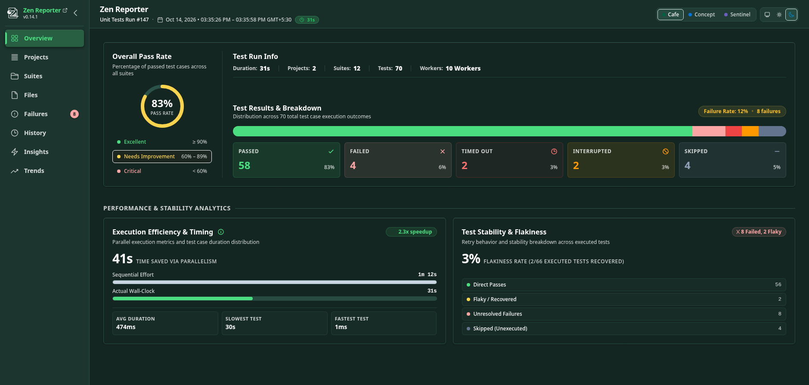
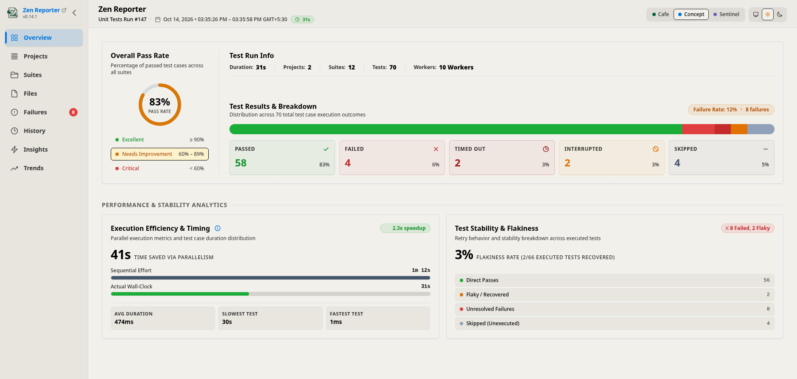
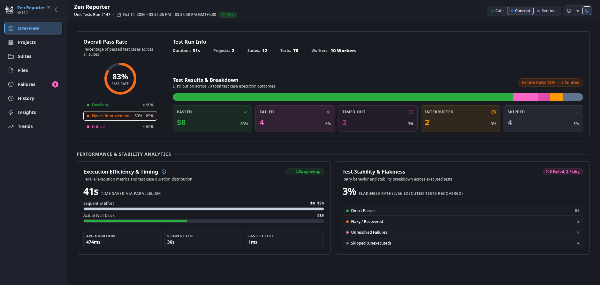
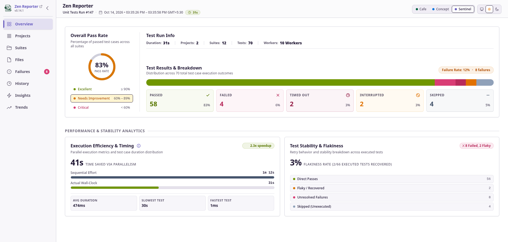
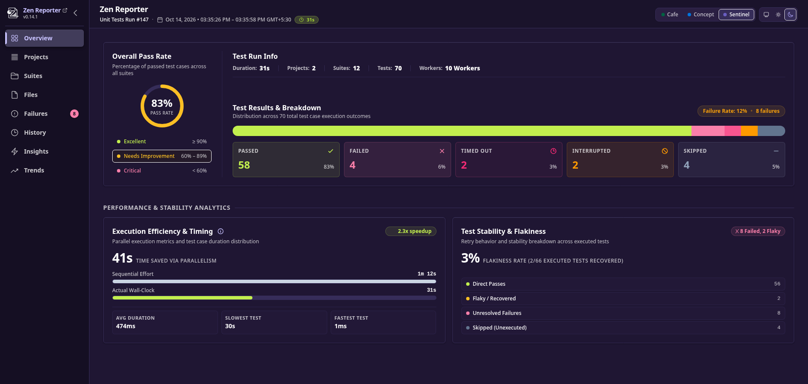
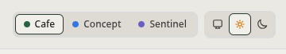

Zen Reporter offers versatile design themes and real-time light/dark mode switching, giving engineers and stakeholders an adaptable, high-contrast visual experience in any work setting.

---

## 🎨 Design Themes

Zen Reporter features three pre-built design themes built with WCAG-compliant color tokens and CSS variables:

| Theme Name             | Style Description                                                                                                                              | Accent Palette          |
| :--------------------- | :--------------------------------------------------------------------------------------------------------------------------------------------- | :---------------------- |
| **`Cafe`** _(Default)_ | Warm, approachable theme featuring a four-tier green brand system layered over a warm cream canvas - inspired by Starbucks’ color palette.     | Starbucks Green / Cream |
| **`Concept`**          | Modern tech theme with vibrant indigo/slate UI surfaces - inspired by Notion’s color palette.                                                  | Indigo / Slate          |
| **`Sentinel`**         | High-contrast cybersecurity theme utilizing deep purple-violet midnight canvas and crisp warning accents - inspired by Sentry’s color palette. | Purple-Violet / Navy    |

### Cafe Theme

Light mode:


Dark mode:


### Concept Theme

Light mode:


Dark mode:


### Sentinel Theme

Light mode:


Dark mode:


---

## ⚙️ Initial Theme & Dark Mode Setup

Set default theme preferences in your `playwright.config.ts`:

```typescript
import { defineConfig } from "@playwright/test";

export default defineConfig({
  reporter: [
    [
      "@arpanp/zen-reporter",
      {
        theme: "Cafe", // 'Cafe' | 'Concept' | 'Sentinel' (default: 'Cafe')
        darkMode: "system", // true | false | 'system' (default: 'system')
      },
    ],
  ],
});
```

---

## 🌓 Interactive UI Controls

Regardless of the initial configuration set in `playwright.config.ts`, users viewing the report can switch visual themes or adjust appearance modes on the fly using the controls in the top header:

<div align="center">



</div>

### 1. Segmented Theme Picker

A segmented pill control located in the top header allows instant switching between themes without reloading the page:

- **`Cafe`**: Selected with a dark green dot indicator.
- **`Concept`**: Selected with an electric blue dot indicator.
- **`Sentinel`**: Selected with a deep purple dot indicator.

### 2. Three-Way Appearance Mode Toggle

An intuitive segmented control allowing one-click selection of your preferred display mode:

- 🖥️ **System**: Automatically syncs the report's appearance with your operating system's or web browser's light or dark mode setting.
- ☀️ **Light Mode**: Forces the light background and palette.
- 🌙 **Dark Mode**: Forces the dark background and dark/midnight palette.
