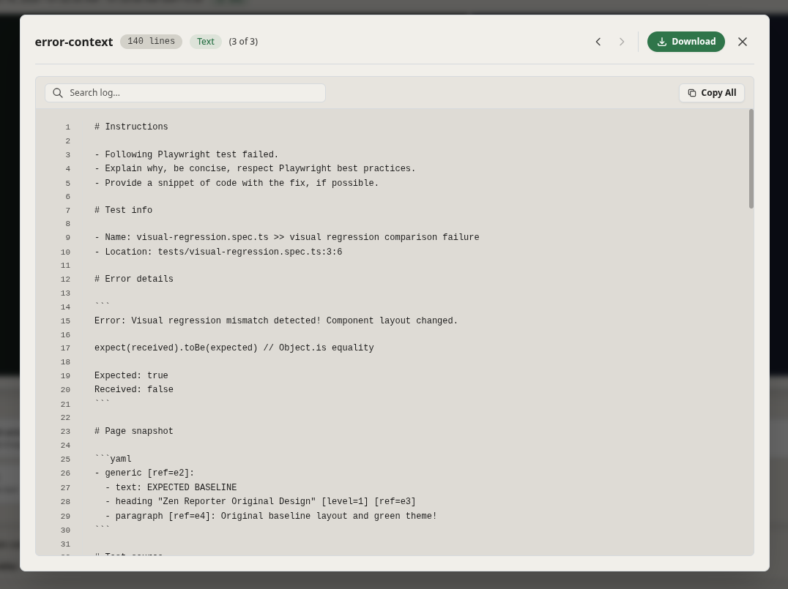
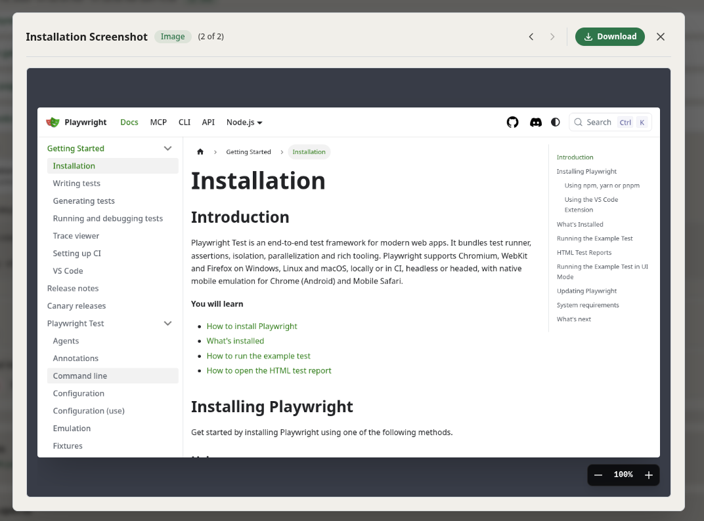
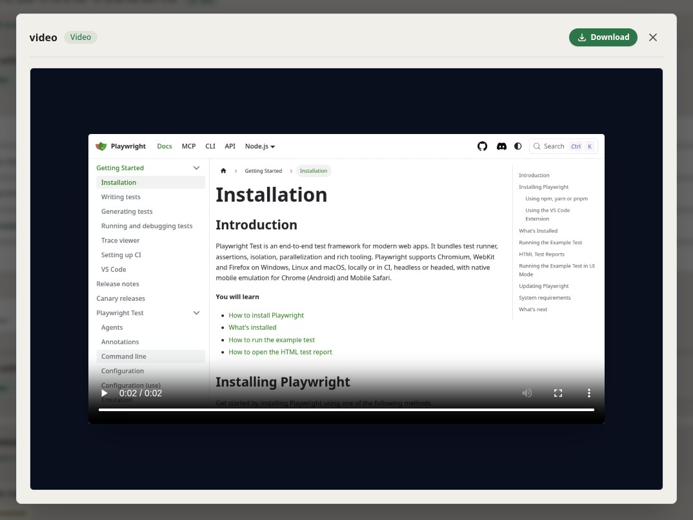
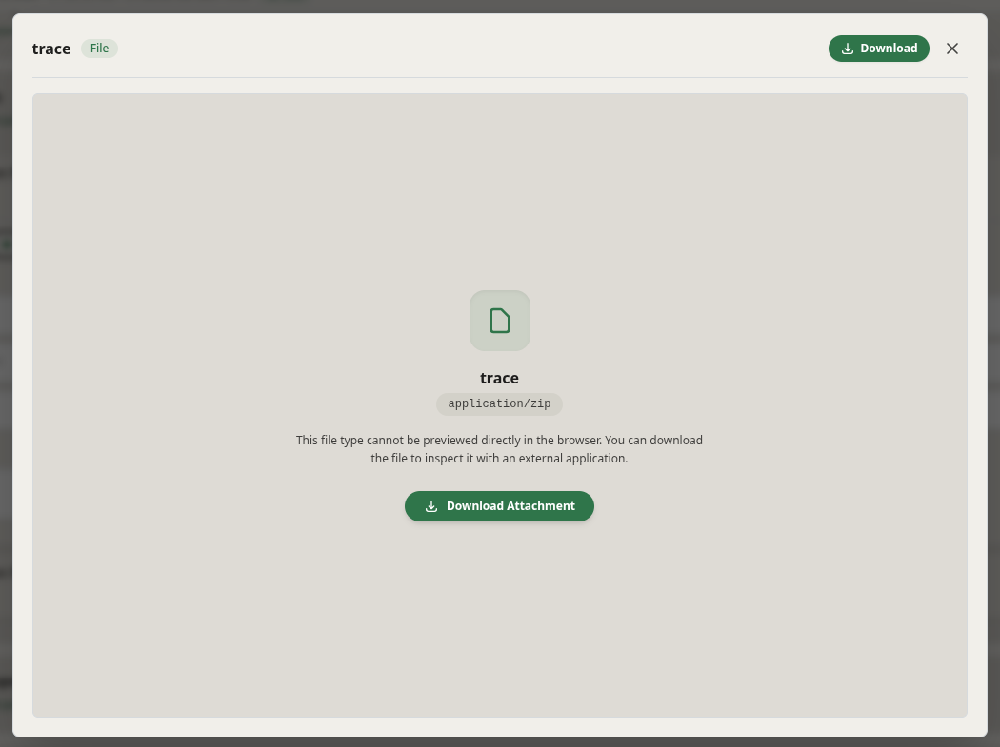

Zen Reporter includes a **Unified Attachment Previewer** designed to inspect logs, console output, screenshots, videos, and arbitrary artifacts without leaving the test report context.

---

## Overview

The attachment previewer provides an integrated, accessible modal dialog powered by a base modal. The base modal dynamically routes attachments into specialized viewports depending on their MIME types and file extensions, providing rich interactions like line-numbered log filtering, image zoom/pan controls, media playback, and direct downloads.

- **Multi-Format Inspection**: Automatically parses stdout, stderr, image diffs, videos, and raw text logs into interactive viewers.
- **Carousel Navigation**: Step sequentially through test artifacts using keyboard arrows (left/right) or header controls.
- **Instant Text Search**: Filter log output with real-time text matching, preserving original line numbers.
- **Lazy Fetching with SPA Resilience**: Fetches raw remote assets on demand, safeguarding against invalid single-page application fallback responses.

---

## Supported Media Types & Viewports

import { Badge } from '@astrojs/starlight/components';

The preview modal maps each item to one of four preview viewports:

| Type | Detection Criteria | Supported Formats | Features |
| :--- | :--- | :--- | :--- |
| <Badge text="text" variant="note" /> | `contentType: text/*` or matching extension | `.txt`, `.log`, `.json`, `.csv`, `.html`, `.xml`, `.md`, `.yaml`, `.yml`, `.js`, `.ts`, `.jsx`, `.tsx`, `.css`, `stdout`, `stderr` | Line numbers, full-text search filter, 1-click clipboard copy, and lazy fetching. |
| <Badge text="image" variant="success" /> | `contentType: image/*` or matching extension | `.png`, `.jpg`, `.jpeg`, `.gif`, `.webp`, `.svg` | Smooth zoom (`25%` to `400%`), mouse-wheel zoom stepping (`±25%`), zoom reset, and aspect preservation. |
| <Badge text="video" variant="tip" /> | `contentType: video/*` or matching extension | `.mp4`, `.webm`, `.ogg`, `.ogv`, `.mov`, `.avi` | Autoplay with standard HTML5 video playback controls. |
| <Badge text="binary" variant="caution" /> | Fallback for non-text / unknown files | `.zip`, `.tar.gz`, `.bin`, `.pdf`, `.wasm`, etc. | MIME-type badge, fallback explanatory prompt, and direct attachment download trigger. |

---

## Key Features & Behaviors

### 1. Carousel & Keyboard Navigation

When multiple artifacts exist for an attempt (e.g. `stdout`, `stderr`, screenshots, traces):

- Use <kbd>&larr;</kbd> and <kbd>&rarr;</kbd> arrow keys to switch between adjacent items.
- Arrow navigation is automatically disabled while focusing on input elements (e.g., the search box).
- Switching items resets the zoom level back to `100%` and clears active log search terms.

### 2. Log Line Search & Original Numbering

- The search bar filters lines instantaneously.
- Preserves the **original file line numbers** in a gutter column so error references remain accurate even when filtered.
- Includes a 1-click **Copy All** button that copies all content lines directly to the system clipboard.

### 3. SPA Fallback Safeguard
When loading text logs lazily via HTTP:

- If a server serves an SPA `index.html` fallback page for missing attachment paths (returning `Content-Type: text/html` on a non-HTML file), the viewer detects this mismatch:
- Displays an inline error badge rather than rendering misleading SPA boilerplate inside the viewer.
