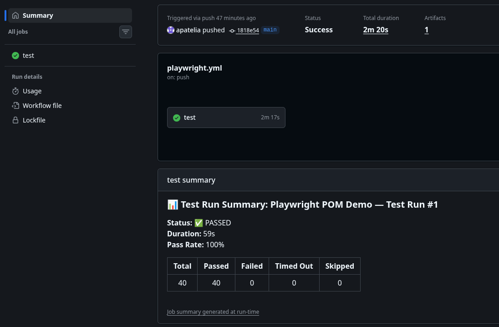
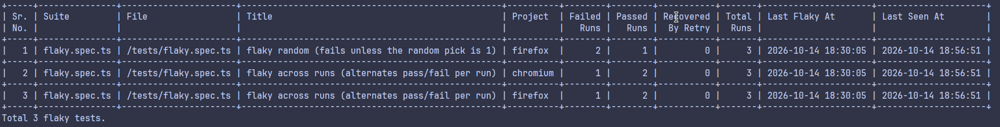

The **Zen Reporter Command-Line Interface (`zr` / `zen-reporter`)** provides a powerful suite of terminal utilities for managing, viewing, summarizing, and querying test run history in **Zen Reporter**. Powered by an embedded **DuckDB analytics engine**, `zr` allows developers and CI/CD pipelines to inspect test run results directly from the terminal, generate markdown summaries for Pull Requests, and run arbitrary SQL queries on historic JSONL run files.

---

## 🏗️ Overview & Binary Setup

When `zen-reporter` is installed as a package dependency, npm/yarn/pnpm exposes two binary aliases:

- `zr`: Short-form convenient alias.
- `zen-reporter`: Full-name binary target.

```bash
# Executing via npx / package runner
npx zr <command> [options]

# Directly via npm scripts in package.json
npm run show
```

### Automatic Package Manager Detection

`zr` intelligently auto-detects the host environment's package manager (`pnpm`, `yarn`, `bun`, or `npm`) by inspecting lockfiles (`pnpm-lock.yaml`, `yarn.lock`, `bun.lock`, `package-lock.json`, `.npmrc`) and `package.json` to execute Playwright CLI commands seamlessly.

---

## 🔍 Commands Reference

### 1. `zr show`

Starts a local static HTTP server to serve the generated Zen Reporter HTML report and automatically launches it in your system's default browser.

If no subcommand is passed to `npx zr` (e.g. running just `npx zr`), `show` is executed by default.

```bash
npx zr show
```

#### Output

```sh
Serving HTML report at http://127.0.0.1:9323
Press Ctrl+C to quit.
```

#### Viewing a report in a custom output directory

```sh
PW_REPORTER_OUTPUT=playwright-report npx zr show
```

#### Specifying a preferred server port

```sh
PORT=8080 npx zr show
```

#### Behavior & Features

- Default Root Directory: Looks for index.html inside the directory specified by `PW_REPORTER_OUTPUT` (defaults to zen-report/ relative to your working directory).
- Local Server: Binds locally to 127.0.0.1.
- Automatic Port Fallback: Starts listening on port 9323 (or the port defined by PORT). If the chosen port is already in use, it automatically increments and attempts the next available port (e.g., 9324, 9325, etc.).
- Auto-open Browser: Automatically detects the host OS and opens the report URL:
- SPA Fallback: If requested subpaths or static assets are not found, requests fallback to index.html.
- Directory Traversal Protection: Sanitizes incoming paths to prevent access outside the configured report directory (returns 403 Forbidden).

---

### 2. `zr summary`

Parses `zen-report/report.json` and prints a structured, GitHub-flavored Markdown summary snippet to stdout. Perfect for pasting into GitHub Actions PR comments or Slack build notifications.

```bash
npx zr summary
```

#### Sample Output

```markdown
### 📊 Test Run Summary: Test Automation Project — Test Run

**Status:** ❌ FAILED
**Duration:** 1m 14s
**Pass Rate:** 85.7%

| Total | Passed | Failed | Timed Out | Skipped |
| :---: | :----: | :----: | :-------: | :-----: |
|  21   |   18   |   2    |     1     |    0    |

#### ❌ Failed Tests (3)

- **[chromium]** `tests/auth.spec.ts` › User login with invalid credentials
- **[firefox]** `tests/checkout.spec.ts` › Complete purchase flow
- **[webkit]** `tests/api.spec.ts` › Fetch user profile timeout
```

#### CI/CD Integration Example (GitHub Actions)

Integrate `zr summary` into your CI/CD pipeline to automatically publish test run results directly to your workflow summary page. In GitHub Actions, pipe the output to the [`$GITHUB_STEP_SUMMARY`](https://docs.github.com/en/actions/writing-workflows/choosing-what-your-workflow-does/workflow-commands-for-github-actions#adding-a-job-summary) environment file:

```yaml
- name: Generate Markdown Summary
  if: always()
  run: npx zr summary >> $GITHUB_STEP_SUMMARY
```

Once configured, your GitHub Actions run will render an executive summary of the test results:



---

### 3. `zr history` (DuckDB Analytics Engine)

`zr history` subcommands execute high-performance analytical queries across historic newline-delimited JSON (`runs/*.jsonl`) files stored in the output directory (`zen-report/runs`).

import { Aside } from "@astrojs/starlight/components";

<Aside type="note">
  `zr history` commands rely on `@duckdb/node-api`. Ensure `@duckdb/node-api` is installed in your project's `devDependencies` or `peerDependencies`.
</Aside>

#### Subcommands

| Command                           | Description                                                                                        |
| :-------------------------------- | :------------------------------------------------------------------------------------------------- |
| `npx zr history`                  | List all historical test runs with start time, duration, and pass/fail/skip counts.                |
| `npx zr history runs`             | Same as above. List all historical test runs with start time, duration, and pass/fail/skip counts. |
| `npx zr history files`            | Summarize historical test execution metrics grouped by spec file.                                  |
| `npx zr history tests`            | Summarize granular historical execution metrics and average durations per test case.               |
| `npx zr history flaky`            | Identify flaky tests that passed in some runs and failed in others.                                |
| `npx zr history regressions`      | List tests that passed in a previous run but failed in the latest run.                             |
| `npx zr history slow [--limit N]` | Rank the top `N` slowest tests by average execution duration across runs (default: 10).            |
| `npx zr history trend`            | Display historical pass rate percentages per run over time.                                        |
| `npx zr history report`           | Build `history.json` and inject it into `index.html` to populate the History & Trends tabs.        |
| `npx zr history query "<SQL>"`    | Run arbitrary DuckDB SQL queries over recorded test runs.                                          |

---

### 4. `zr env`

Prints environment diagnostic information to stdout, useful for verifying package versions and debugging environment setup in CI/CD pipelines or local development. If you ever need to report a bug against Zen Reporter, then this command can come handy.

```bash
npx zr env
```

#### Reported Details

- **`zen-reporter` version**: Installed version of Zen Reporter.
- **`@playwright/test` version**: Installed Playwright framework version.
- **Node.js version**: Active Node.js runtime version.
- **OS**: Host operating system and platform architecture.

#### Example Output

```text
zen-reporter version: 0.14.2
@playwright/test version: 1.64.0
Node.js version: v20.11.0
OS: macOS
```

---

## 💻 Terminal Table Formatting Engine

`zr history` features a built-in terminal table renderer designed for CLI legibility:

1. **Auto-wrapping & Column Flexing**: Responsive column width calculation prevents line-wrapping on narrow screens.
2. **Proper Header Casing**: Converts database column names into clean display headers, i.e. `Avg Duration`.
3. **Smart Formatting**:
   - Millisecond durations are formatted as human-readable durations (`1m 24s` or `45s`).
   - Timestamps are formatted into ISO local dates (`YYYY-MM-DD HH:MM:SS`).
   - Numbers and percentages are right-aligned while text fields remain left-aligned.



---

## ⚡ Custom SQL Querying with `zr history query`

The `query` subcommand grants full access to DuckDB's SQL syntax. The table/view `runs` is automatically bound to `read_json('zen-report/runs/*.jsonl', format='newline_delimited')`.

```bash
# Query failed tests in WebKit project with duration > 5000ms
npx zr history query "SELECT file, title, duration_ms FROM runs WHERE project = 'webkit' AND status = 'failed' AND duration_ms > 5000 ORDER BY duration_ms DESC"
```

> Tip: Use [JSONL schema](../history-archiving/#jsonl-schema-structure) to construct your queries.
